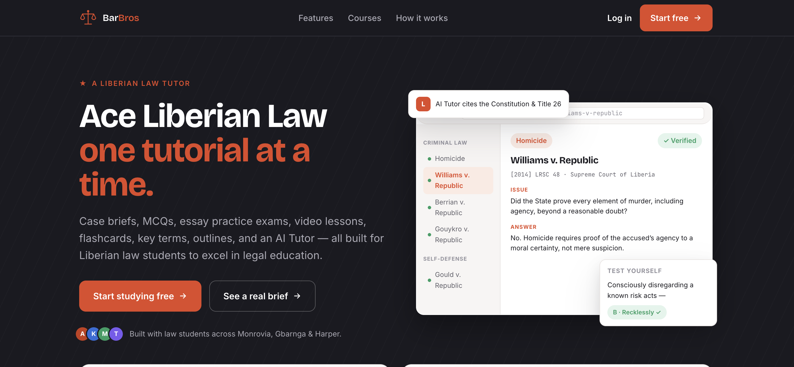
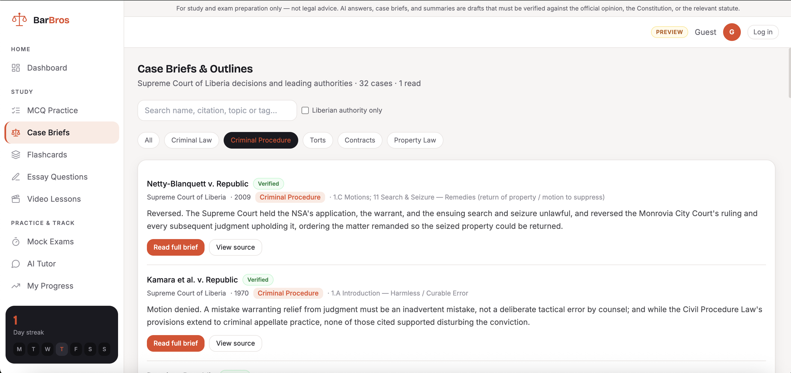
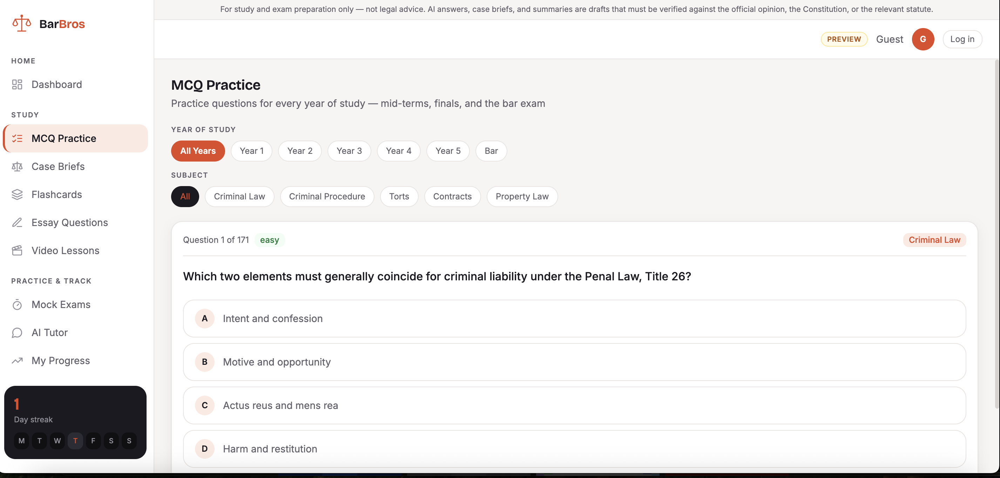

# BarBros

**Study platform for Liberian law students, built on Liberian statutes and Supreme Court decisions.** Personal project, in development. Source code is private; this page gives an overview.

Law students in Liberia have few digital study tools built for their legal system. BarBros offers the kind of tutorial platform US law students use, with content written for Liberian law.

## Features

- **Case briefs** in a consistent six-part format, each linked to its source
- **Flashcards** for key terms, **multiple-choice practice**, **essay questions** with model outlines and a timed **mock exam**
- **Video lesson scripts** for each course
- **Progress tracking:** accuracy by subject, cases read and a daily streak
- **AI tutor** using the Anthropic Claude API, for signed-in users

## Content so far (first-year courses)

426 case briefs and 171 practice questions across five courses.

| Course | Case briefs | Flashcards | Practice questions | Essays |
|---|---|---|---|---|
| Criminal Law | 79 | 74 | 42 | 16 |
| Criminal Procedure | 32 | 46 | 30 | 13 |
| Torts | 112 | 78 | 30 | 14 |
| Contracts | 93 | 81 | 32 | 14 |
| Property Law | 118 | 88 | 37 | 14 |

## Architecture

- **Web:** Next.js 14 (App Router), TypeScript, Tailwind, Zustand for client state
- **API:** Express with Prisma and PostgreSQL, handling accounts (JWT) and the AI tutor
- **Security:** Helmet, rate limiting, bcrypt password hashing, Zod validation
- **Content:** typed TypeScript data files as a single source of truth, checked by the compiler

## Tech stack

Next.js · TypeScript · Tailwind CSS · Express · Prisma · PostgreSQL · Anthropic Claude API
